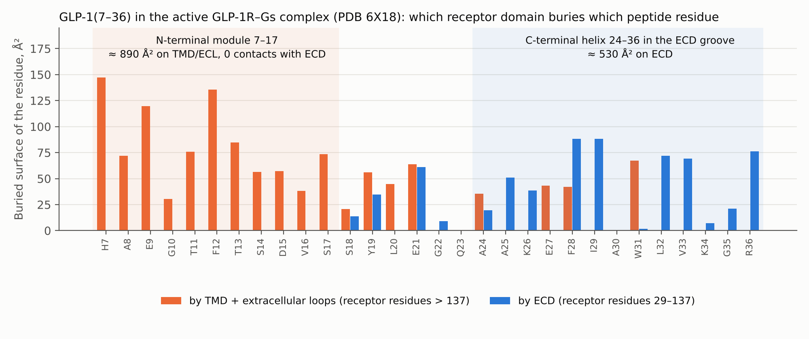
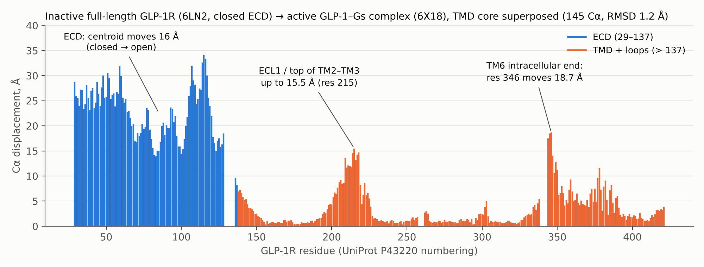
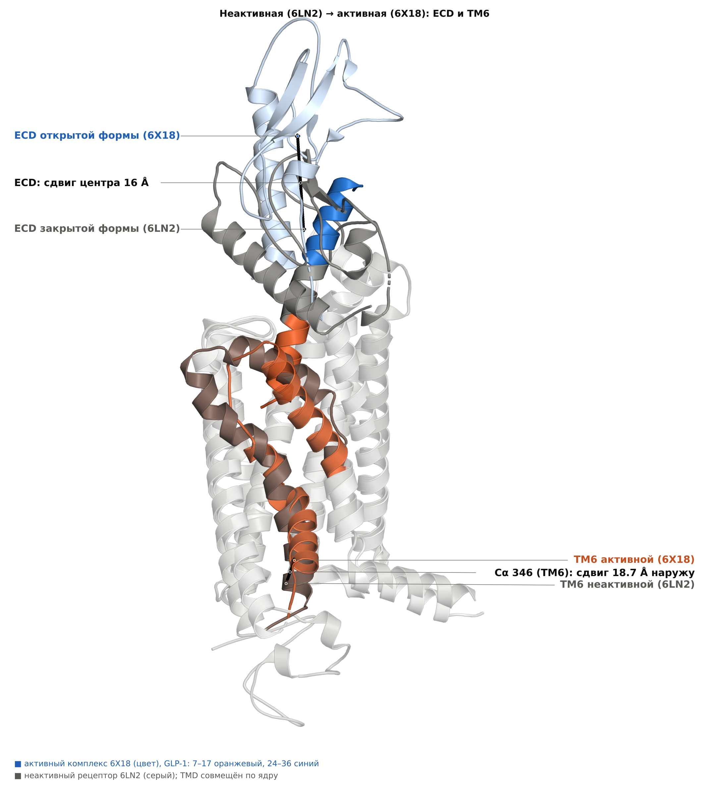
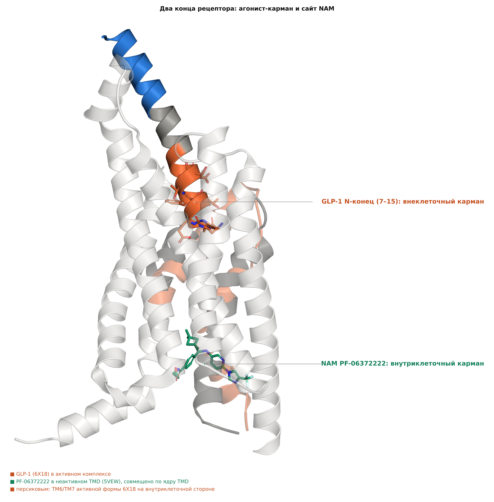
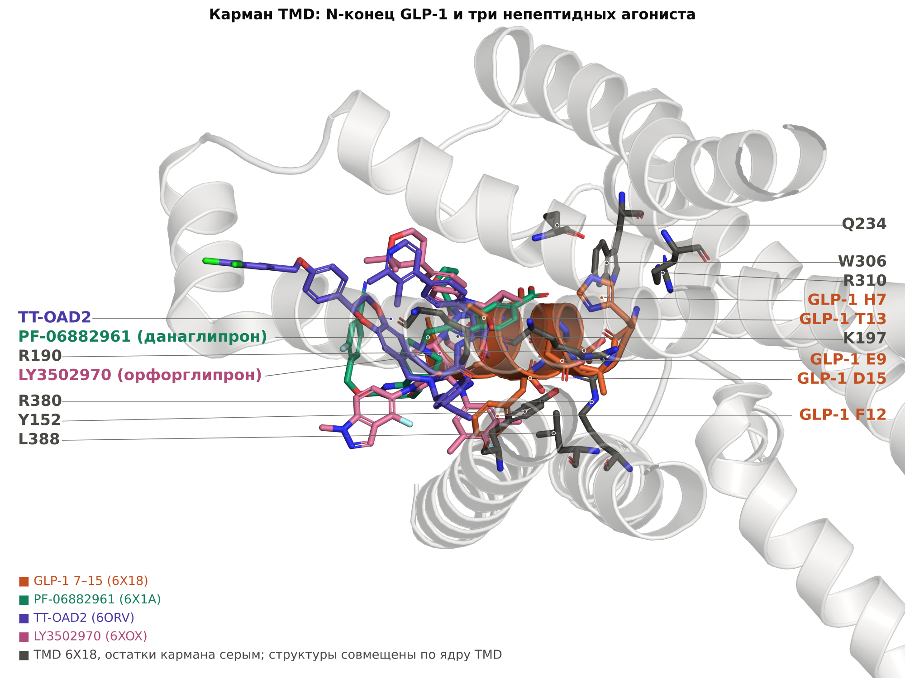
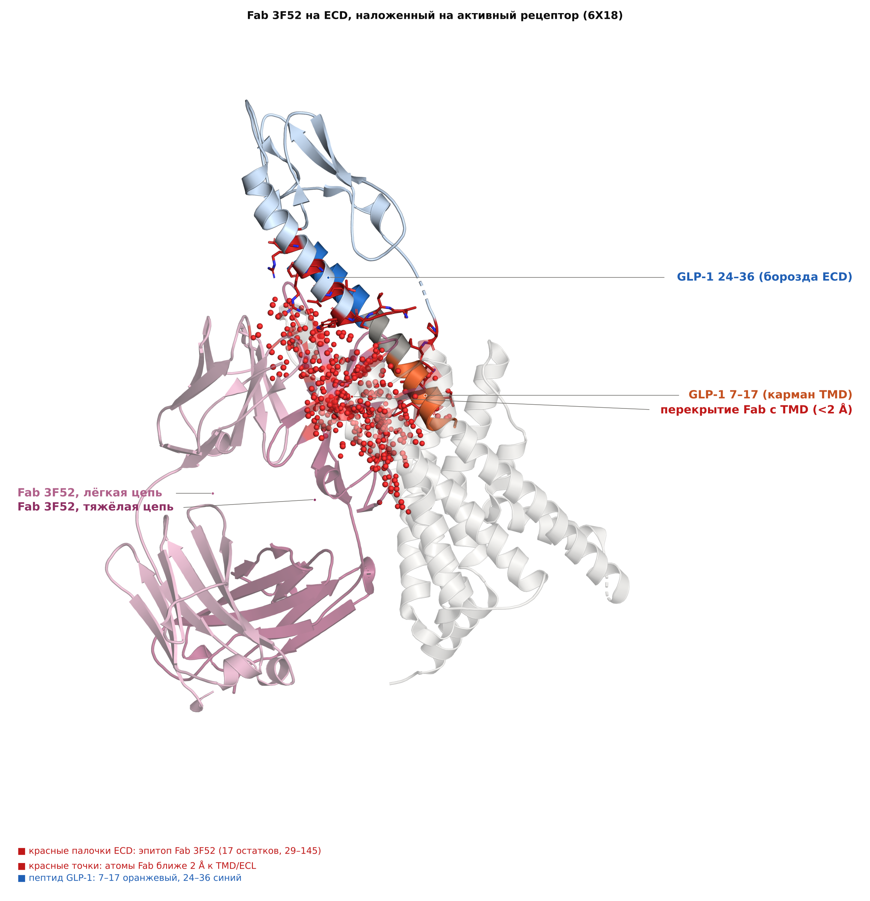
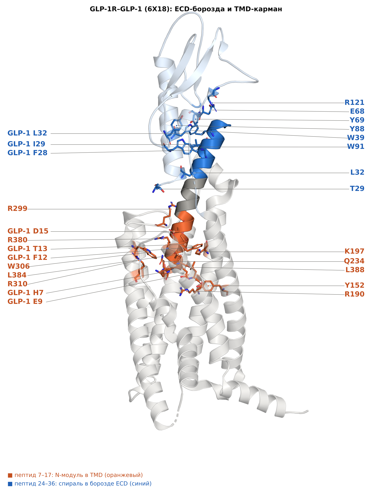
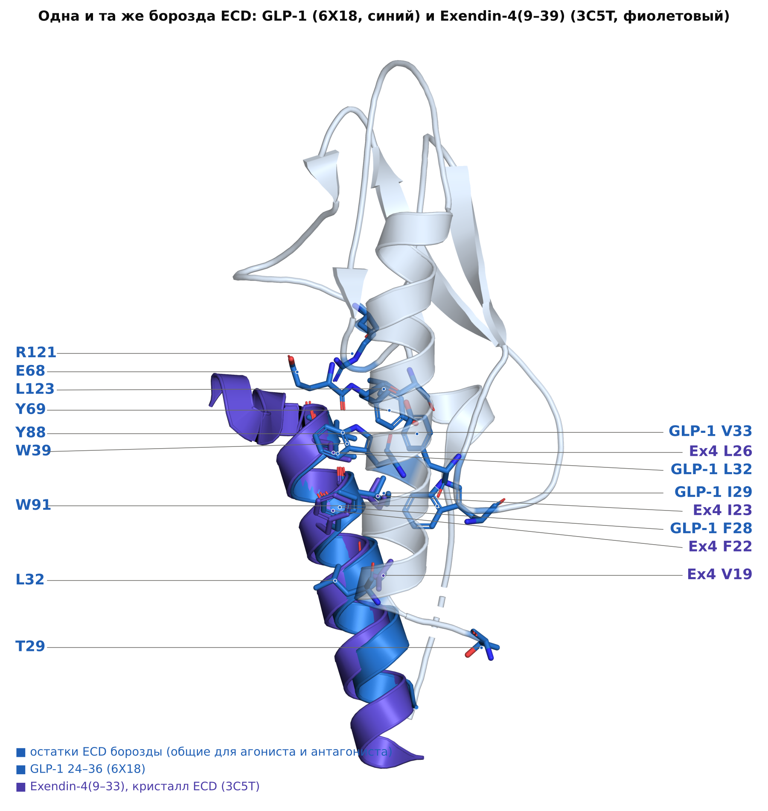
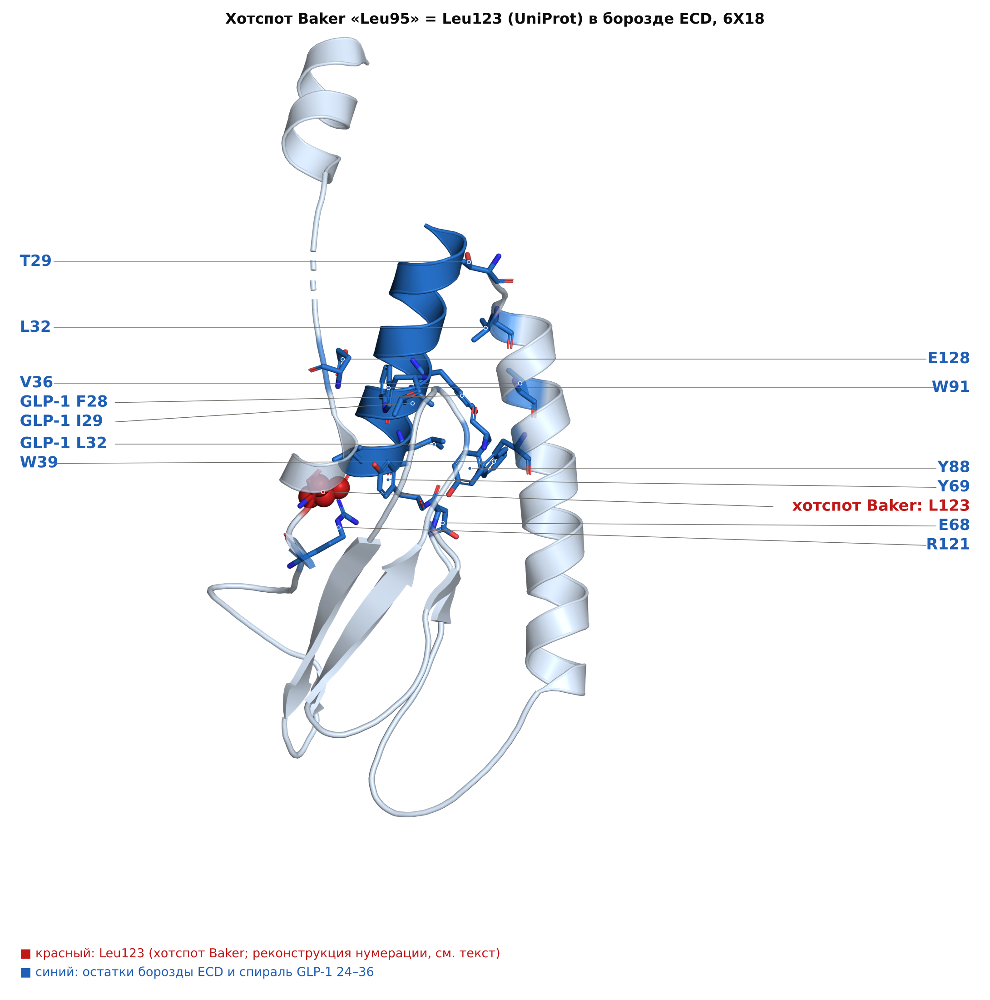

# Связывание агонистов и антагонистов GLP-1R: что учитывать при дизайне

2026-10-20 · версия в Claude Docs: https://claude.ai/artifact/3DE6iaK2HfZ9Pfbe6fvoJW · таблица: GLP1R_agonist_vs_antagonist.xlsx

## Резюме

Агонист и антагонист GLP-1R садятся в одну и ту же борозду ECD; разницу создаёт N-концевой модуль, который у агониста уходит в карман TMD на 20–35 Å от борозды, а у антагониста отсутствует. Для Challenge 3 это значит: биндер только в борозде получит кредит за KD, но не выиграет.

1. **Пептид поделён на два модуля.** В 6X18 остатки GLP-1 7–17 скрывают ≈ 890 Ų только на TMD/ECL и не касаются ECD; остатки 24–36 лежат в борозде ECD (≈ 530 Ų). Расстояние от H7 до центра борозды — 35 Å.
2. **Борозда у обоих одна и та же.** У Ex(9–39), GLP-1 и GLP-1 в полноразмерном рецепторе общие 14–15 из 16–18 остатков ECD; на изолированном ECD Ex(9–39) имеет IC50 ≈ 6 нМ, GLP-1 — > 500 нМ.
3. **Переход резкий.** Удаление 3–7 остатков у Ex4 даёт антагонисты в 4–10 раз сильнее Ex(9–39); у GLP-1 удаление 8 остатков убивает активность, 2 — оставляет слабый агонизм. Классификация зависит от тест-системы: GLP-1(9–36) — агонист при высокой экспрессии рецептора и антагонист при низкой.
4. **Активное состояние одно, путей к нему много.** В 15 анализированных Gs-структурах (пептиды, малые молекулы, PAM, а также без лиганда) TM6 сдвинут на 18–19 Å от неактивной формы; меняются положение ECD и глубина лиганда. Малые молекулы активируют без борозды и без глубокой вставки H7.
5. **ECD-блокаторы любого формата — антагонисты.** Fab 3F52 (≈ 3 нМ), TB-222-023, de novo минибелки Baker (IC50 39–61 нМ), большинство из 13 антител Liu 2021. Опубликованного de novo белка-агониста класса B без природного пептидного модуля в литературе не найдено.
6. **Для дизайна** нужна схема «якорь в борозде + мост ≈ 17 остатков + N-модуль, дотягивающийся до Q234, W306, R190, Y152, K197». Аналоги работали (CLAMP на PTHR1, GLP-1 на лёгкой цепи антитела), но с природным модулем — а правило конкурса «de novo и zero-shot» не позволяет модифицировать существующий binder; трактовку нужно уточнить у организаторов до 25 октября.
7. **Что неизвестно.** Условия клеточного теста (линия, экспрессия, доза или кривая) и прямые данные по de novo белку на GLP1R; пункты 5–6 — наша интерпретация литературы и расчётов по структурам.

## Контекст: Challenge 3 (GLP1R) конкурса Anthropic × Adaptyv

Задача 3 звучит как «Design a GLP1R agonist»: засчитывается только дизайн, который связывает рецептор **и** активирует его в клеточном тесте; приём дизайнов до 25 октября 2026, 23:59 AoE. Поэтому различие между связыванием агониста и антагониста здесь определяет, получит ли дизайн зачёт вообще.

| Параметр | Условие (по [странице задачи](https://proteinbase.com/competitions/anthropic-adaptyv-2026/challenges/glp1r)) |
|---|---|
| Мишень | Человеческий GLP1R, UniProt P43220, остатки 24–432 (ECD + TMD); референсная структура PDB 6X18, цепь R. Белок в DDM/CHS, с нераскрытыми термостабилизирующими мутациями |
| Формат лиганда | Одна цепь 10–250 а.о., нанотело, scFv или Fab; только de novo; метки (FLAG, His, Twin-Strep) не считаются мишенью |
| Тест связывания | Дизайн иммобилизован, рецептор в растворе, pH 7.4. Зачёт: фитируемая кривая с KD либо сдвиг ассоциации >300% над негативным контролем |
| Функциональный тест | Репортёр в клетках человека: CRE → секретируемая щелочная фосфатаза (SEAP, люминесценция). Сравнение с необработанными клетками и референсным агонистом |
| Критерий победы | «A design must be an agonist, confirmed in a functional assay, to count». Среди агонистов выше активация относительно референса, затем выше аффинность |
| Подсказка организаторов | Целиться в «функциональный эпитоп», например пептид-связывающую борозду ECD, куда садятся GLP-1, эксенатид и семаглутид; «a hint, not a rule» |
| Лимиты | До 40 дизайнов (Track 1) и до 20 (Tracks 2–3); CSV с name, sequence, molecule_class |

Страница не раскрывает тип прибора для теста связывания (SPR или BLI) и точный состав референсного агониста; их нужно уточнить в чате конкурса. Общие правила и публичный промпт отбора — на [странице конкурса](https://proteinbase.com/competitions/anthropic-adaptyv-2026).

## Архитектура GLP-1R и двухдоменная модель связывания

Пептидный лиганд делится на две функционально разные половины: C-концевая спираль даёт аффинность на ECD, N-концевая половина лезет в TMD и даёт эффективность. Это «two-domain / two-step» модель, подтверждённая и кристаллами изолированного ECD, и крио-ЭМ полноразмерного рецептора ([Zhang 2017](https://doi.org/10.1038/nature22394); [López de Maturana 2003](https://doi.org/10.1074/jbc.M212147200); [Underwood 2010](https://doi.org/10.1074/jbc.M109.033829)).

Мы посчитали это количественно на референсной структуре конкурса 6X18 (GLP-1(7–36) в комплексе с GLP1R и Gs, 2.1 Å; [Zhang 2020](https://doi.org/10.1016/j.molcel.2020.09.020)): площадь, скрытая лигандом, считалась по SASA (зонд 1.4 Å), ECD = остатки 29–137, всё остальное = TMD + петли ECL.

| Сегмент GLP-1 | Что контактирует | Скрытая площадь, Ų | Ключевые остатки рецептора (≤4 Å) |
|---|---|---|---|
| 7–17 (N-конец) | только TMD и ECL, контактов с ECD нет | ≈ 890 (≈ 48% всего интерфейса) | Q234, V237, W306, I309, R310 (H7); Y152, R190, L388 (E9); K197, F230, T298 (T13); R380, L384 (D15) |
| 18–23 (переход) | смесь ECD и ECL1/ECL2 | ≈ 280 (≈ 120 на ECD) | Y205, R299, E138 |
| 24–36 (C-конец) | почти только ECD (гидрофобная борозда) | ≈ 690 (≈ 530 на ECD) | F28, I29, L32, V33 лиганда; T29, L32, W39, E68, Y69, W91, R121 рецептора |

Итого на лиганде скрыто ≈ 1860 Ų: примерно треть на ECD (≈ 650 Ų) и две трети на TMD/ECL (≈ 1260 Ų; доли не аддитивны). Пептид — почти непрерывная α-спираль 7–36 (расстояния Cα i→i+4 = 5.9–6.6 Å), длиной около 40 Å: от H7 до центра ECD-борозды 35 Å.

Три следствия, которые важны для дизайна:

- **Борозда ECD — общая для агонистов и антагонистов.** Скрытая поверхность ECD с Ex4(9–39), с GLP-1 (3IOL) и с GLP-1 в полноразмерном рецепторе (6X18) совпадает почти полностью: 14–15 остатков из 16–18 общие ([Runge 2008](https://doi.org/10.1074/jbc.M708740200); [Underwood 2010](https://doi.org/10.1074/jbc.M109.033829); собственный расчёт).
- **Аффинность живёт на ECD.** Изолированный ECD связывает Ex4 и Ex(9–39) с IC50 ≈ 6 нМ, GLP-1 — с IC50 > 500 нМ; Ala-скан GLP-1: F28A ухудшает аффинность в 1300 раз, I29A — в 93, L32A — в 17 раз ([Underwood 2010](https://doi.org/10.1074/jbc.M109.033829)).
- **Активация требует двух крупных перестроек.** Между закрытой апо-формой (ECD лежит на TMD, 6LN2; [Wu 2020](https://doi.org/10.1038/s41467-020-14934-5)) и активной 6X18 после совмещения TMD центр ECD сдвигается на 16 Å, а Cα остатка 346 на внутриклеточном конце TM6 — на 18.7 Å (собственный расчёт, RMSD ядра 1.2 Å).

*Рис. A. Те же смещения на трёхмерной структуре: цветом — активный комплекс 6X18, серым — неактивный рецептор 6LN2 (TMD совмещён по ядру из 145 остатков, RMSD 1.24 Å). Центр ECD в открытой форме сдвинут на 16 Å, Cα 346 в TM6 — на 18.7 Å наружу. Независимые неактивные TMD без ECD (5VEW, 5VEX, 6KJV, 6KK1, 6KK7) дают тот же сдвиг TM6: 17.6–18.0 Å (наш расчёт).*

*Рис. B. Два конца TMD. Вверху — N-конец GLP-1 (7–15) в ортостерическом кармане; внизу — отрицательный аллостерический модулятор PF-06372222 из структуры 5VEW (TMD совмещён с 6X18 по ядру). NAM садится снаружи спиралей TM5–TM7, в нижней (внутриклеточной) половине TMD, не конкурирует с пептидом за карман и ограничивает подвижность TM6 (Song 2017). Для дизайна: белок, который добавляют снаружи клетки, может работать только на внеклеточной стороне (борозда ECD и верхний карман); внутриклеточный сайт NAM ему недоступен.*

## Как связываются агонисты

Агонист — это лиганд, который не просто садится на рецептор, а бьёт в TMD-карман и переводит рецептор в состояние, способное связать Gs. Для пептидов это N-концевые остатки 7–17: H7 даёт контакты с Q234, W306, I309, R310; E9 — с R190 и Y152; T13 — с K197; D15 — с R380 (расчёт по 6X18, ≤4 Å). Эти контакты раскручивают внеклеточную половину TM6 и сдвигают её наружу; поворот через пролин-глициновый шарнир TM6 открывает цитоплазматическую щель для α5-спирали Gs ([Zhang 2017](https://doi.org/10.1038/nature22394)).

Полная статистика по всем Gs-связанным агонист-комплексам даёт неожиданный результат: **TM6 одинаков у любого агониста** (Cα остатка 346 в пределах 0.2–1.5 Å от 6X18 и на 18–19 Å от неактивной 6LN2), а различаются положение ECD и глубина лиганда. То есть «агонизм» — это вопрос того, достигается ли это состояние, а не вопрос его геометрии.

| Лиганд (PDB) | Класс | Скрыто на ECD, Ų | Скрыто на TMD/ECL, Ų | Смещение ECD от 6X18, Å | Центр лиганда от Cα H7, Å |
|---|---|---|---|---|---|
| GLP-1(7–36) (6X18) | нативный пептид | 651 | 1265 | 0 | 22.8 |
| Семаглутид (7KI0) | пептидный препарат | 598 | 1152 | 1.1 | 23.2 |
| Тирзепатид (7FIM) | пептидный препарат | 553 | 1108 | 1.0 | 21.9 |
| Exendin-P5 (6B3J) | пептид, G-биас | 694 | 1319 | 5.3 | 23.1 |
| GLP-1(9–36) (9IVG) | метаболит, частичный агонист | 430 | 666 | 6.8 | 26.6 |
| PF-06882961 (6X1A) | непептид | 199 | 648 | 5.9 | 15.0 |
| CHU-128 (6X19) | непептид | 198 | 804 | 6.1 | 13.4 |
| LY3502970 (6XOX) | непептид, частичный | 170 | 741 | 7.1 | 13.5 |
| Boc5 (7X8R) | непептид | 146 | 762 | 11.5 | 12.6 |

Расчёт автора по структурам RCSB (SASA с зондом 1.4 Å; ECD = остатки ≤137; совмещение по ядру TMD). Центр лиганда — центр тяжёлых атомов; у 9IVG моделировано только 21 остаток (9–29).

*Рис. C. Верхний карман TMD. Оранжевый — GLP-1 7–15 (6X18); зелёный — PF-06882961 (данаглипрон, 6X1A); фиолетовый — TT-OAD2 (6ORV); розовый — LY3502970 (орфорглипрон, 6XOX). Структуры совмещены по ядру TMD; серые палочки — остатки кармана 6X18. Малые молекулы лежат мельче пептида (центр на 13–15 Å от H7 против 22–23 Å у пептидов) и перекрываются с ним лишь частично: активация возможна без глубокого контакта с остатками H7–F12.*

Чего эта таблица не даёт напрямую: все эти структуры стабилизированы Gs/Nb35, поэтому они описывают уже достигнутый активный комплекс, а не энергетику перехода и не долю лигандов, способных этого добиться.

**Три вида агонизма**

- **Пептиды (GLP-1, Ex4, семаглутид, тирзепатид).** Два контакта одновременно: борозда ECD даёт аффинность, N-конец в кармане — эффективность. Влияет и сама эффективность: N-конец должен быть гибким, но склонным к спирали — потенция разных ограниченных аналогов менялась на тысячи раз и коррелировала со спиральностью ([Oddo 2018](https://doi.org/10.1021/acs.biochem.8b00105); [Cary 2022](https://doi.org/10.1038/s41589-021-00945-w)).
- **Непептидные агонисты.** Садятся мельче (центр на 13–15 Å от H7 против 22–23 Å у пептидов), в верхний карман TMD, и часто контактируют с ECD (150–200 Ų). У LY3502970 карман образуют ECD, ECL2 и TM1/2/3/7; важен приматоспецифичный W33 ECD ([Kawai 2020](https://doi.org/10.1073/pnas.2014879117)). TT-OAD2 укладывается в непредсказанный карман и перестраивает ECL3/TM6/TM7 без прямого контакта в глубине ([Zhao 2020](https://doi.org/10.1038/s41586-019-1902-z)). Ключевой вывод: активация возможна без борозды ECD и без глубокого контакта H7.
- **Allo-агонисты и PAM** (BETP, LSN3318839, compound 2). Compound 2 ковалентно садится на C347 на цитоплазматическом конце TM6 и сам толкает его наружу ([Cong 2021](https://doi.org/10.1038/s41467-021-24058-z)). В его структуре без пептида (7DUR) N-концевые остатки ECD T29–E34 лежат в 3.8–5.3 Å от места, где в 6X18 стоят остатки GLP-1 7–15 (собственный расчёт), что совпадает с моделью «встроенного агониста» в ECD ([Yin 2016](https://doi.org/10.1038/celldisc.2016.42)).

## Как связываются антагонисты и аллостерические ингибиторы

Классический антагонист GLP-1R связывается с **той же бороздой ECD, что и агонист**, но не втыкает в TMD-карман N-конец с H7–A8. В терминах двухдоменной модели: аффинность осталась, эффективность исчезла. Переход идёт резко, в пределах одного-двух остатков: удаление одной аминокислоты у Ex4 снижает агонизм, удаление 3–7 даёт антагонисты в 4–10 раз сильнее Ex(9–39); у GLP-1 удаление двух остатков даёт слабый агонист, восьми — неактивный пептид ([Montrose-Rafizadeh 1997](https://doi.org/10.1074/jbc.272.34.21201)). Причём у экзендина связывание и активация разнесены по доменам, а у GLP-1 сильнее связаны (та же работа).

| Класс | Пример (PDB) | Сайт | Числа и факты |
|---|---|---|---|
| N-усечённый пептид | Exendin(9–39) = avexitide (3C59, 3C5T) | борозда ECD | IC50 на изолированном ECD ≈ 6 нМ; амфипатичная α-спираль, Trp-cage в связывании не участвует; конкурентный антагонист с t½ ≈ 30 мин в/в, 44 исследования на людях ([Runge 2008](https://doi.org/10.1074/jbc.M708740200); [Gasbjerg 2021](https://doi.org/10.1111/dom.14507)) |
| Антитело (Fab) | Fab 3F52 (5E94) | ECD: α-спираль + стебель 137–145 | IC50 связывания ≈ 3 нМ, подавления cAMP ≈ 10 нМ; нейтральный антагонист (нет агонизма до 1 µМ); блокирует даже короткий пептидный агонист, но не аллостерический малый ([Hennen 2016](https://doi.org/10.1038/srep26236)) |
| Антитело (IgG) | TB-222-023 | ECD (фаг-дисплей на клетках) | сильнее avexitide in vitro, работает в островках пациента с гиперинсулинизмом ([Peterson 2023](https://doi.org/10.2337/db22-1039)) |
| De novo минибелок | dGl1_024, mGl1_008 (Baker lab) | ECD (хотспот «Leu95» у авторов = Leu123 по UniProt, остаток борозды; нумерация реконструирована нами, см. раздел про ключевые остатки) | IC50 61 и 39 нМ; Kd 27 и 5.3 нМ; из ≈ 17 000 дизайнов в дрожжевом дисплее, 49 экспрессированы ([Baker 2025 preprint](https://doi.org/10.1101/2025.03.23.644666)) |
| NAM (малая молекула) | PF-06372222 (5VEW), NNC0640 (5VEX) | внеспиральный карман снаружи TM5–7 у цитоплазматической половины | разрешение 2.7 и 3.0 Å; ограничивают подвижность внутриклеточного конца TM6 ([Song 2017](https://doi.org/10.1038/nature22378)) |

**Геометрия ECD-блокатора (расчёт по 5E94).** Эпитоп Fab 3F52 — 17 остатков ECD, ≈ 970 Ų; он перекрывает лишь 7 из 16 (44%) остатков борозды GLP-1 (T29, V30, L32, T35, V36, W39, E68) и заходит на стык ECD–TM1 (остатки 137–145). Наша интерпретация (не доказано авторами): чтобы заблокировать даже короткий пептидный агонист, не зависящий от борозды, Fab может просто занимать объём над входом в TMD — эпитоп дотягивается до стыка ECD–TM1.

*Рис. D. Fab 3F52 (5E94), совмещённый своим ECD с ECD в активном комплексе 6X18 (жёсткое наложение, RMSD 1.2 Å по 100 Cα). Красные палочки — 17 остатков эпитопа на ECD; красные точки — 405 атомов Fab ближе 2 Å к остаткам TMD и петель (138–423). Для второй копии Fab в кристалле таких атомов 392, при наложении на неактивную форму 6LN2 — 712 и 862 (всего в Fab ≈ 3370 атомов). Наша интерпретация: Fab закрывает вход в TMD, а не только борозду, поэтому блокирует даже короткий пептидный агонист. Оценка грубая: ECD связан с TMD гибким линкером, и реальный Fab может сидеть под другим углом.*

**Метаболит GLP-1(9–36) — случай на границе.** Без H7–A8 он проявляет «слабый частичный агонизм» ([Acta Pharm Sin B 2024](https://doi.org/10.1016/j.apsb.2024.09.002)), но в клеточных линиях с высокой экспрессией рецептора ведёт себя как агонист, а при низкой — как слабый антагонист ([Knudsen 2012](https://doi.org/10.1016/j.regpep.2011.12.006)). Поэтому «агонист/антагонист» — свойство пары лиганд + тест-система, не структуры в вакууме.

## Сводная таблица: агонист против антагониста

В одной фразе: **аффинность и антагонизм даёт ECD-борозда, агонизм — контакт с TMD-карманом на расстоянии ≥ 20 Å от неё**. Модульность подтверждает химера глюкагона (N-конец) + GLP-1 (C-конец), которую с высокой аффинностью узнают оба рецептора ([Hjorth 1994](https://pubmed.ncbi.nlm.nih.gov/7527026/)), и Ala-скан GLP-1: боковые цепи 7, 10, 12, 13, 15 непосредственно нужны для взаимодействия, а 28 и 29 — для спиральной конформации ([Adelhorst 1994](https://pubmed.ncbi.nlm.nih.gov/8119974/)).

| Признак | Агонист (пептид) | Агонист (непептид) | Антагонист / ECD-биндер | NAM (TMD) |
|---|---|---|---|---|
| Борозда ECD | да, C-половина (24–36), ≈ 530–650 Ų | не нужна; контакт ECD 150–200 Ų (W33 у LY3502970) | да, главный вклад в аффинность (Ex(9–39) ≈ 6 нМ; Fab 3F52 ≈ 3 нМ) | нет |
| N-конец (H7–F12) в TMD | да, ≈ 890 Ų, нуль контактов с ECD | нет глубокого контакта; верхний карман (центр 13–15 Å от H7) | нет: N-конец удалён (Ex(9–39)) или отсутствует (белок) | не относится |
| Положение ECD | открыто, сдвиг на 16 Å от закрытой формы | промежуточное (5–7 Å от пептидного, 10–11 Å от закрытого) | ECD связан, полноразмерная структура без агониста — закрытая (6LN2, без лиганда) | закрытая (6LN2 была с NAM) |
| TM6 (Cα 346) | наружу на 18–19 Å | то же (18–19 Å) | не переводит в активное состояние | удерживает внутриклеточный конец TM6 |
| Связь аффинность–эффективность | сильная у GLP-1, слабее у экзендина | разрыв: аффинность низкая, эффект есть | разрыв в обратную сторону: аффинность высокая, эффекта нет | — |
| Чувствительность к тест-системе | низкая | частью частичные агонисты (LY3502970) | высокая у пограничных лигандов (GLP-1(9–36): агонист при высокой экспрессии, антагонист при низкой) | — |
| Примеры | GLP-1, Ex4, семаглутид, тирзепатид | PF-06882961, LY3502970, TT-OAD2, CHU-128 | Ex(9–39), Fab 3F52, TB-222-023, dGl1_024 | PF-06372222, NNC0640 |

Расчёты — собственные по структурам RCSB; полный реестр из 80 структур GLP-1R с классификацией — в прилагаемой таблице (XLSX/CSV).

## Ключевые остатки рецептора: что общее, а что только для агонистов

На структуре 6X18 (нумерация UniProt P43220, как в PDB) остатки рецептора делятся на три группы. **Общие** — ECD-борозда и несколько остатков TMD, снижающих аффинность и GLP-1, и Ex(9–39): они дают аффинность любому лиганду и сами по себе не активируют. **Агонист-специфичные** — только в TMD (K197, D198, Q234, W284, K288, R310): их Ala-замены снижают аффинность GLP-1 преимущественно (D198 и R310 — только GLP-1), а у K197, W284 и R310 потенция падает сильнее аффинности. **Структурные** — контакты N-конца в 6X18 без прямого функционального теста (R299, W306, R380, L384, L388). Для дизайна из этого следует простое правило: контакт с бороздой нужен любому биндеру, а различие между антагонистом и агонистом задают контакты с остатками второй и третьей групп.

*Рис. E. GLP-1R–GLP-1 (6X18, 2.1 Å). Синий — C-половина пептида (24–36) и остатки борозды ECD; оранжевый — N-концевой модуль (7–17) и остатки кармана TMD. Подписаны остатки из таблицы ниже. Расчёт собственный (PyMOL, SASA в Biopython); структура с классами остатков в B-факторе — 6X18_GLP1R_hotspots.pdb в папке structures/ репозитория.*

| Остатки рецептора | Элемент | Контакт в GLP-1 (6X18) | Что показано | Класс |
|---|---|---|---|---|
| T29, V30, L32, T35, V36, W39, E68, Y69, Y88, P90, W91, R121, L123, E128 | ECD, борозда | F28, I29, L32, V33 и др. (24–36) | Скрытая поверхность ECD совпадает у Ex4(9–39), GLP-1 с изолированным ECD и GLP-1 в полноразмерном рецепторе: 14–15 общих остатков (наш расчёт; Runge 2008, Underwood 2010) | Общий |
| Y152 (TM1), R190 (TM2), Y235 (TM3) | TMD | E9 (Y152, R190) | Ala снижает аффинность и GLP-1, и Ex(9–39); R190–E9 — полярный контакт центральной сети (Coopman 2011, Zhang 2017) | Общий |
| H363, E364 | TM6 | — | Ala снижает аффинность обоих лигандов; H363A полностью разобщает рецептор и cAMP (Coopman 2011) | Общий; сопряжение |
| K197, D198 | TM2 | T13 (K197) | K197: Ala снижает аффинность преимущественно GLP-1, потенция падает сильнее аффинности; D198: только аффинность GLP-1 (Coopman 2011); обе замены снижают связывание (Xiao 2000) | Агонист-специфичный |
| Q234 | TM3 | H7 | Ala снижает аффинность преимущественно GLP-1 (Coopman 2011) | Агонист-специфичный |
| W284, R310 | ECL2 / верх TM4; TM5 | H7 (R310) | W284: Ala снижает аффинность преимущественно GLP-1; R310: только GLP-1; у обоих потенция падает сильнее аффинности (Coopman 2011) | Агонист-специфичный |
| K288 | ECL2 / TM4 | — | Замены резко снижают аффинность пептидов с полным N-концом, но не их N-усечённых аналогов (Al-Sabah & Donnelly 2003) | Агонист-специфичный (N-конец) |
| T298, R299 | ECL2 | H7 (R299, H-связь), S14, S17 | Структурный контакт; R299 дотягивается до H7 (Zhang 2017) | Структурный |
| W306, R380, L384, L388; L141, L144, Y148 | ECL3 / TM5–6; TM7; верх TM1 | H7, G10, T11 (W306); T11, D15 (R380); A8, T11, D15 (L384); E9, F12 (L388); F12 (TM1) | Контакты N-конца в 6X18 (наш расчёт); функционально не проверены | Структурный |
| Q211, H212 | ECL1 | W31 | Контакт C-концевой части пептида с ECL1 — возможная причина частичного агонизма GLP-1(15–36) (Zhang 2017) | Структурный |
| C226–C296 | ECL1–ECL2 | — | Дисульфид функционально связан с карманом активации (Mann 2010) | Структурный |
| W33 | ECD | — | Приматоспецифичный контакт с орфорглипроном LY3502970 (Kawai 2020) | Малые молекулы |
| C347 | ICL3 / TM6 | — | Ковалентный сайт аллостерического агониста compound 2 у цитоплазматического конца TM6 (Cong 2021) | Аллостерический |

*Рис. F. Одна и та же борозда ECD у агониста и антагониста: C-спираль GLP-1 (6X18, синий) и Exendin-4(9–33) (3C5T, фиолетовый), совмещённые по ECD. Подписаны остатки борозды и боковые цепи пептидов (F28, I29, L32, V33 у GLP-1; V19, F22, I23, L26 у Ex4).*

*Рис. G. Где лежит хотспот Baker для GLP1R. Leu123 (UniProt; в статье «Leu95») — красные сферы; синий — остатки борозды ECD и спираль GLP-1 24–36 в 6X18. Leu123 сидит на краю борозды: с пептидом его связывает только контакт с V33 (минимальное расстояние 4.0 Å, два атомных контакта ≤ 4.5 Å), тогда как у W39 — 22 контакта с F28, L32 и R36. Нумерация хотспота — наша реконструкция (см. текст ниже). Косвенное подтверждение сайта связывания в самой работе: в SPR-экспериментах на конкуренцию dGl1_024 и mGl1_008 перекрываются по сайту с эндогенным лигандом (Supplementary Fig. 41d,e), а в тесте на клетках Ex(9–39) даёт IC50 13.9 нМ против 61 нМ у dGl1_024.*

**Ограничения таблицы.** Деление на «общие» и «агонист-специфичные» взято из Ala-сканов с радиолигандом, то есть из аффинности, а не из геометрии. Классы «структурный» и «малые молекулы» означают только контакт в одном комплексе. Граница ECD/TMD влияет на расчёты: при границе ≤ 130, ≤ 137 и ≤ 145 доля ECD в скрытой площади GLP-1 равна 0.33, 0.35 и 0.43. N-модуль 7–17 не касается ECD при границах до 137 и получает 114 Ų контакта только при 145, то есть со «стеблем» ECD–TM1; вывод о раздельных модулях от границы не зависит.

**Нумерация хотспотов у Baker et al.** Из 11 хотспотов, названных в Methods для пяти мишеней, 8 совпадают с UniProt (все три у GCGR, все три у CXCR4, W72 и F92 у CLR). Не совпадают GLP1R «Leu95» (в UniProt остаток 95 — Val), GIPR «Met32» (в UniProt остаток 32 — Ala) и CLR «Leu33» (в UniProt Gln33, ближайший Leu — L34). Для GLP1R и GIPR номера удалось восстановить: это порядковый номер остатка в усечённой цепи рецептора (Methods: целевые структуры усечены до области эпитопа). 95-й разрешённый остаток цепи R в 5VAI, 6X18 и 7DUQ — Leu123 (UniProt), 32-й остаток цепи R в 7FIN — Met67. Это именно заявленные типы остатков (Leu и Met) в обоих рецепторах, в структурах, названных в Methods. Leu123 входит в наш список остатков борозды (R121, L123, E128), а Met67 у GIPR выровнен с E68 GLP1R в том же мотиве FD(E/M)Y. Это наша реконструкция по двум совпадениям, авторы её не описывают; правило не сработало в 6VCB (ECD разрешён с пропусками) и для CLR (6E3Y, 3N7S, 7KNU): там W72 и F92 совпадают с PDB и UniProt напрямую, а Leu33 близок к L34, то есть смещён на один. Значит, у Baker возможны и разные соглашения о нумерации, и опечатки.

## Смещённый агонизм и качество активации

«Агонист или нет» — не бинарно: один и тот же лиганд даёт разный Emax по путям cAMP, β-аррестина и Ca²⁺. Для конкурса важно только Gs → cAMP → CRE-SEAP, поэтому G-белок-смещённые лиганды не проигрывают, а итог зависит от кинетики и амплификации сигнала.

- **Смещение — норма для лигандов GLP-1R.** Exendin-P5 даёт другую организацию ECL3/прилегающих TM и угол α5-спирали Gαs, отличающийся на 6° ([Liang 2018](https://doi.org/10.1038/nature25773)); тирзепатид на GLP-1R смещён к cAMP ([Willard 2020](https://doi.org/10.1172/jci.insight.140532)); замена A8V в GLP-1 делает лиганд G-белок-смещённым по отношению к интернализации при той же аффинности ([van der Velden 2021](https://doi.org/10.1021/acsptsci.0c00193)); непептиды TT-OAD2 и LY3502970 — смещённые и частичные (часть структур из таблицы выше).
- **Структурный источник.** Две зоны: TM5/TM6 и ECL2 ведут к cAMP и Ca²⁺, TM1/TM7 — к pERK ([Lei 2018](https://doi.org/10.1074/jbc.RA118.003278)). Динамика N-конца важнее статики: краткие контакты на дне полости коррелируют с быстрой активацией Gs ([Deganutti 2022](https://doi.org/10.1038/s41467-021-27760-0)); подвижность N-терминального «домена активации» определяет эффективность ([Cary 2022](https://doi.org/10.1038/s41589-021-00945-w)).
- **Уровень экспрессии меняет классификацию.** Высокая экспрессия рецептора повышает потентность высокоаффинных лигандов (Kd не меняется) и максимальный эффект слабых; GLP-1(9–36) ведёт себя как агонист при высокой экспрессии и как антагонист при низкой ([Knudsen 2012](https://doi.org/10.1016/j.regpep.2011.12.006)). Для репортёра CRE-SEAP, который интегрирует cAMP за несколько часов, это значит: видность слабого частичного агонизма зависит от уровня экспрессии, который Adaptyv не раскрыл (наш вывод). Для ориентира (ссылка в списке источников): коммерческая HEK293-линия с таким же репортёром CRE→SEAP у InvivoGen заявляет ≈ 1000 рецепторов на клетку, то есть физиологический уровень, где по Knudsen слабые частичные агонисты могут не проявляться. Ранжирование «относительно референсного агониста» в любом случае награждает высокую эффективность.
- **Открытый вопрос к организаторам:** меряется ли активация при одной концентрации или по кривой «доза–ответ», и в какой клеточной линии с какой экспрессией рецептора.

## Что это значит для дизайна агониста

Биндер в ECD-борозде — это антагонист по умолчанию; чтобы он был агонистом, для него нужна вторая часть, дотягивающаяся до TMD. Ниже — принципы, отсортированные по надёжности опоры; пометка «наша интерпретация» означает, что авторы источника этого не утверждали.

| # | Принцип | Опора | Что делать в дизайне | Уверенность |
|---|---|---|---|---|
| 1 | Борозда ECD даёт аффинность и по умолчанию антагонизм | Ex(9–39) ≈ 6 нМ; Fab 3F52 ≈ 3 / 10 нМ, нейтральный; минибелки Baker IC50 61 / 39 нМ; в панели из 13 антител ([Liu 2021](https://doi.org/10.1080/19420862.2021.1893425)) большинство антагонисты | Такой дизайн получит кредит за KD («binding at the peptide groove counts in its favour»), но не выиграет. Борозду брать как якорь, не как цель агонизма | Высокая |
| 2 | Активирует N-концевой модуль в TMD | Остатки 7–17 скрывают ≈ 890 Ų только на TMD/ECL; Ala-скан: 7, 10, 12, 13, 15; усечение на 2 — слабый агонист, на 8 — ничего | Нужен элемент, который дотянется до Q234, W306, R190, Y152, K197, L388. Без него шанс активации мал | Высокая (необходимость); низкая (как сделать de novo) |
| 3 | Геометрия «двухсайтного» (bitopic) лиганда | Cα H7 — 35 Å от центра борозды, 20 Å от ближайшего Cα ECD (P137); у GLP-1 непрерывная спираль из 30 остатков | Якорь в борозде (≈ 13 остатков) + мост ≈ 17 остатков + модуль в кармане; N-конец должен быть свободным (метка Twin-Strep у конкурса — на C-конце) | Средняя (оценка по 6X18) |
| 4 | Принцип ECD-якорь + N-агонистный модуль уже работал | Нанотело к ECD PTHR1 + N-фрагмент PTH дали активность ([Cheloha 2020](https://doi.org/10.1038/s41467-020-15884-8)); GLP-1, слитый с лёгкой цепью нефункционального антитела, дал агониста (Liu 2021); мембранно-привязанные лиганды: активность даёт N-конец ([Fortin 2009](https://doi.org/10.1073/pnas.0900149106)) | Рабочая схема, но во всех трёх случаях модуль — природная последовательность | Средняя–высокая |
| 5 | Размер якоря и вход в TMD | Fab 3F52 блокировал даже короткий пептидный агонист; эпитоп доходит до остатков 137–145 | Компактный минибелок (<100 а.о.) с N-концевым плечом к TMD вместо Fab/нанотела, которые рискуют закрыть вход | Низкая–средняя (наша интерпретация) |
| 6 | Состояние ECD | В апо-форме ECD «закрыт» (центр на 16 Å ближе к TMD); борозда тем не менее доступна на 88% от изолированного ECD (994 против 1125 Ų, расчёт) | Якорь свяжется и с апо-рецептором в детергенте; модуль обязан «открыть» ECD. Мишень для моделирования — 6X18 (открытая), как и рекомендуют организаторы | Средняя |
| 7 | Альтернатива без борозды | Малые молекулы активируют из верхнего кармана (13–15 Å от H7); de novo агонисты MRGPRX1 (класс A) получены через мотив-скаффолдинг пептида из 5 остатков (Baker); для класса B — только антагонисты | В принципе можно целиться в верхний карман, но примеров для белков на GLP1R нет | Низкая |
| 8 | Пробный пример «de novo без сходства с GLP-1» | EvoBind: 18-мер циклический пептид, cAMP EC50 32 нМ на GLP1R (лираглутид 2.4 нМ); 15- и 31-мер — 5–12 µМ; последовательности не похожи на известные агонисты ([Li 2025, препринт](https://doi.org/10.1101/2025.06.06.658268)) | Малые пептиды («микробиндеры» <40 а.о. в классификации конкурса) — реальный путь; циклизация в экспрессионных белках доступна лишь через S–S | Низкая (препринт, 3 пептида) |
| 9 | Правило новизны конкурса | FAQ 8: «de novo и zero-shot», нельзя «взять существующий binder и модифицировать»; шкала новизны Adaptyv: ≤ 30% идентичности по MMseqs2 | Вставка 9–15 остатков GLP-1 в N-конец — серая зона по правилам. До вложения усилий — уточнить у организаторов (Slack) | Правило — факт; трактовка неясна |

**Эвристики для фильтрации дизайнов (наши предложения, не валидированы):** в предсказанном комплексе с полноразмерным рецептором (6X18, цепь R) проверять, что (а) якорь бьёт в ECD-борозду (≥ 500 Ų контакта, остатки T29, L32, W39, E68, Y69, W91, R121); (б) N-концевой модуль лежит в радиусе 4.5 Å от ≥ 6 из ключевых остатков кармана (Y152, R190, K197, Q234, W306, R310, R380, L384, L388); (в) нет столкновений с ECL2 (R299) и TM6/TM7.

## Что уже делали в de novo и ИИ-дизайне

В просмотренной литературе нет ни одного опубликованного de novo **белка**-агониста рецептора класса B без природного пептидного фрагмента: de novo белки для GLP1R, GIPR и GCGR оказались антагонистами, а de novo агонисты GPCR получены для класса A. Единственные de novo агонисты GLP1R — малые пептиды.

| Работа | Что проектировали | Результат | Чем полезна для Challenge 3 |
|---|---|---|---|
| [Baker lab 2025 (препринт), Nature 2026](https://doi.org/10.1101/2025.03.23.644666) | De novo минибелки для GPCR (RFdiffusion + метапротеомная библиотека) | Класс B (GLP1R, GIPR, GCGR, CGRPR), мишень ECD — антагонисты (GLP1R: 49 из ≈ 17 000 дизайнов экспрессированы, 2 антагониста, IC50 61 и 39 нМ). Класс A: агонисты MRGPRX1 (полный и частичный, крио-ЭМ в пределах 0.7 Å от модели) через motif-scaffolding пептида из 5 остатков | Прямое подтверждение пункта 1; рецепт «мотив в глубокий карман + скаффолд» переносим только гипотетически |
| [Chai-2, bioRxiv 2025](https://doi.org/10.1101/2025.11.29.691346) | De novo антитела (VHH, IgG) к 6 GPCR классов A и C | Функциональные агонисты: CCR8 (VHH, EC50 292 нМ, сниженный Emax) и CXCR4 (частичный, ≈ 164 нМ); эпитоп — ортостерический карман. Класса B в работе нет | Агонизм белка достижим при цели в ортостерический карман, но это мелкие карманы класса A |
| [EvoBind, Li 2025 (препринт)](https://doi.org/10.1101/2025.06.06.658268) | Циклические пептиды 15/18/31 а.о. для GCGR по первичной последовательности | Все три активируют GLP1R (EC50 32 нМ у 18-мера; лираглутид 2.4 нМ); сходства с известными агонистами нет | Единственный пример коротких «без GLP-1» агонистов; препринт, 3 пептида |
| [Wei 2025, Adv Sci](https://doi.org/10.1002/advs.202507044) | ProteinMPNN на скелете семаглутида (7KI0), 13 сайтов зафиксированы: H7, Aib8, E9, G10, T11, F12, T13, S14, D15, S17, K26, R34, G37 | 10 000 → 60 прошли фильтры → 52% успеха in vitro; D13 с t½ в 3 раза дольше семаглутида | Показывает минимальный набор консервативных активирующих остатков; это перепроектирование аналогов GLP-1, по правилам конкурса не de novo |
| [Liu 2021, mAbs](https://doi.org/10.1080/19420862.2021.1893425) | Антитела из синтетической GPCR-библиотеки (длинный HCDR3 с лигандными мотивами) | 13 антител, большинство антагонисты; агонист — только с GLP-1 на лёгкой цепи | Прямое подтверждение пунктов 1 и 4 |
| [Ma 2020, Sci Adv](https://doi.org/10.1126/sciadv.aax7379); [Fontaine 2024](https://doi.org/10.1038/s41467-024-50827-7) | Класс A: sdAb-агонист рецептора апелина (JN241-9); нанотело-агонист MC4R | Антагонист JN241 → агонист превращён одной вставкой Tyr в CDR3, который входит в ортостерический карман; агонисты MC4R отобраны против активного состояния и сидят глубоко в кармане | CDR3 может дойти до ортостерического кармана; селекция на активное состояние рецептора даёт агонисты |
| [Cheloha 2020](https://doi.org/10.1038/s41467-020-15884-8) | CLAMP: нанотело к PTHR1 + N-фрагмент PTH | Слабые N-фрагменты PTH становятся активными и селективными | Прецедент пункта 4 для класса B1 |
| [AMG 133 (JMC 2026)](https://doi.org/10.1021/acs.jmedchem.6c00032) | Антитело против GIPR (антагонист) + пептиды GLP-1 (агонист) | Фаза III | Антитело-блокатор ECD и пептид-агонист в одной молекуле |

Вывод: доказанные способы получить агонизм на рецепторах класса B — (1) пептиды с N-концевым фармакофором, (2) слияния с ECD-связывающим доменом, (3) малые молекулы, (4) для класса A — CDR3 в ортостерическом кармане. Первые два нуждаются в природном модуле, третий не подходит по типу молекулы, четвёртый не переносим на класс B на данных просмотренной литературы. При буквальном прочтении Challenge 3 просит сделать то, для чего подтверждённого de novo прецедента для белков класса B нет.

## Ограничения и что проверить дальше

Худшее место в цепочке — перенос выводов с структур на поведение белка в клеточном тесте, условия которого организаторы не раскрыли.

- **Структуры стабилизированы Gs/Nb35.** Они показывают уже достигнутое активное состояние (даже без лиганда, 7RG9 и 8WG7), а не то, насколько лиганд способен его вызвать.
- **Нет структуры полноразмерного GLP1R с ECD-антагонистом.** Fab 3F52 (5E94) решён только с ECD, поэтому мысль о «блоке входа в TMD» — геометрическая интерпретация по данным авторов блокировки короткого пептида.
- **Наши расчёты приблизительны.** Граница ECD/TMD — остаток 137; площади «скрыто» неаддитивны; разрешение структур 2.1–4.2 Å; у 9IVG смоделировано только 21 остаток, у 7LLL разрешение 3.7 Å, так что там суммы занижены.
- **16 из 80 записей PDB без публикации** (2025–2026). Классификация по заголовкам; тип лиганда у 9N05 и 9N1P (SRB103Q/H) не проверен.
- **Условия теста неизвестны:** клеточная линия и экспрессия, время, одна доза или кривая, референсный агонист, а также мутации термостабилизированного конструкта.
- **Схема «якорь + N-модуль» — гипотеза по аналогии.** CLAMP и антитело с GLP-1 на лёгкой цепи не были de novo, а прямых данных по de novo белку на GLP1R нет.
- **Препринты.** Baker lab (теперь также Nature 2026), EvoBind и Chai-2: числа Chai-2 взяты из первых 100 000 из 134 067 символов текста, последовательности EvoBind выведены из раздела «Методы», нумерация хотспота Leu95 у Baker реконструирована нами как порядковый номер в усечённой цепи (Leu123 в UniProt), авторами не подтверждена.

**Что делать дальше**

- [ ] Спросить организаторов в Slack: считается ли нарушением «zero-shot» встройка короткого структурного мотива N-конца GLP-1; что измеряется — одна концентрация или кривая; какая линия клеток.
- [ ] В предсказанных комплексах с рецептором 24–432 проверять эвристики (а)–(в) из раздела про дизайн.
- [ ] Строить пары «с модулем / без модуля», чтобы тест различал вклад N-модуля и конкурс опубликовал и негативные результаты.
- [ ] В ранжировании дизайнов оставить часть слотов под ECD-онли биндеры: они дают шанс на приз за KD и служат контролем метода.

## Литература и источники

Все источники открыты и прочитаны (абстракт или полный текст) 20 октября 2026; структуры — [RCSB PDB](https://www.rcsb.org), нумерация рецептора — UniProt P43220. Полный список с PMID — на листе «10 Источники» в XLSX.

**Конкурс**

- [Challenge 03: GLP1R, Proteinbase](https://proteinbase.com/competitions/anthropic-adaptyv-2026/challenges/glp1r) · [выбор дизайнов](https://proteinbase.com/competitions/anthropic-adaptyv-2026/selection) · [критерии новизны Adaptyv](https://www.adaptyvbio.com/blog/novelty) · [формат CRE-SEAP-теста (InvivoGen)](https://www.invivogen.com/incretin-bioassay-glp-1-reporter-cell-line)

**Двухдоменная модель и структуры**

- [Runge 2008](https://doi.org/10.1074/jbc.M708740200) · [Underwood 2010](https://doi.org/10.1074/jbc.M109.033829) · [López de Maturana 2003](https://doi.org/10.1074/jbc.M212147200) · [Montrose-Rafizadeh 1997](https://doi.org/10.1074/jbc.272.34.21201)
- [Zhang 2017](https://doi.org/10.1038/nature22394) · [Jazayeri 2017](https://doi.org/10.1038/nature22800) · [Song 2017](https://doi.org/10.1038/nature22378) · [Liang 2018](https://doi.org/10.1038/nature25773) · [Zhang 2020](https://doi.org/10.1016/j.molcel.2020.09.020) · [Wu 2020](https://doi.org/10.1038/s41467-020-14934-5)
- [Zhou 2025, обзор](https://doi.org/10.1016/j.tips.2025.03.003) · [Liang 2020, класс B](https://doi.org/10.1016/j.molcel.2020.01.012) · [Yin 2016](https://doi.org/10.1038/celldisc.2016.42) · [White 2026](https://doi.org/10.1016/j.molpha.2026.100111)

**Агонисты и аллостерика**

- [Kawai 2020](https://doi.org/10.1073/pnas.2014879117) · [Zhao 2020](https://doi.org/10.1038/s41586-019-1902-z) · [Bueno 2020](https://doi.org/10.1038/s41589-020-0589-7) · [Cong 2021](https://doi.org/10.1038/s41467-021-24058-z) · [Zhao 2022](https://doi.org/10.1038/s41467-022-28683-0) · [Sun 2022](https://doi.org/10.1073/pnas.2116506119)
- [Cary 2022](https://doi.org/10.1038/s41589-021-00945-w) · [Oddo 2018](https://doi.org/10.1021/acs.biochem.8b00105) · [Deganutti 2022](https://doi.org/10.1038/s41467-021-27760-0) · [Fortin 2009](https://doi.org/10.1073/pnas.0900149106)

**Антагонисты и антитела**

- [Hennen 2016](https://doi.org/10.1038/srep26236) · [Peterson 2023](https://doi.org/10.2337/db22-1039) · [Liu 2021](https://doi.org/10.1080/19420862.2021.1893425) · [Gasbjerg 2021](https://doi.org/10.1111/dom.14507) · [Knudsen 2012](https://doi.org/10.1016/j.regpep.2011.12.006)

**Смещённый агонизм**

- [Willard 2020](https://doi.org/10.1172/jci.insight.140532) · [Lei 2018](https://doi.org/10.1074/jbc.RA118.003278) · [Jones 2018](https://doi.org/10.1038/s41467-018-03941-2) · [van der Velden 2021](https://doi.org/10.1021/acsptsci.0c00193)

**Мутагенез и ключевые остатки рецептора**

- [Coopman 2011](https://doi.org/10.1210/me.2011-1160) · [Xiao 2000](https://doi.org/10.1677/jme.0.0250321) · [Al-Sabah & Donnelly 2003](https://doi.org/10.1016/s0014-5793(03)01043-3) · [Mann 2010](https://doi.org/10.1016/j.peptides.2010.09.015) · [Runge 2008](https://doi.org/10.1074/jbc.M708740200) · [Underwood 2010](https://doi.org/10.1074/jbc.M109.033829)

**De novo и ИИ-дизайн, антитела-агонисты**

- [Baker lab 2025](https://doi.org/10.1101/2025.03.23.644666) · [Baker lab, Nature 2026](https://doi.org/10.1038/s41586-026-10656-8) · [Chai-2 2025](https://doi.org/10.1101/2025.11.29.691346) · [EvoBind 2025](https://doi.org/10.1101/2025.06.06.658268) · [Wei 2025](https://doi.org/10.1002/advs.202507044) · [Fan 2025](https://doi.org/10.1021/jacs.4c12808)
- [Cheloha 2020](https://doi.org/10.1038/s41467-020-15884-8) · [Ma 2020](https://doi.org/10.1126/sciadv.aax7379) · [Fontaine 2024](https://doi.org/10.1038/s41467-024-50827-7) · [Skiba 2026](https://doi.org/10.1016/j.molpha.2026.100110)

As of: 2026-10-20.
